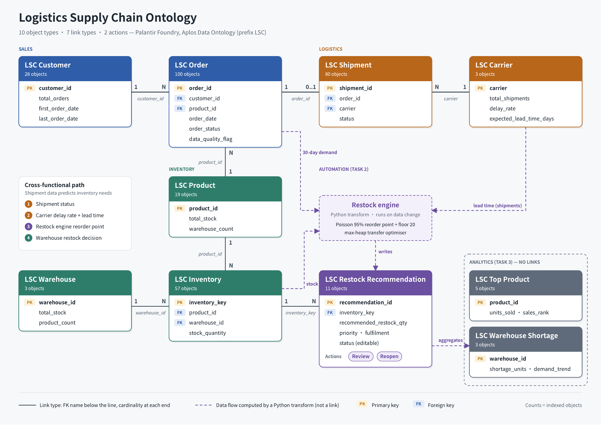

# Logistics Supply Chain Control Tower — Palantir Foundry

**Three separate business systems (orders, shipments, inventory) brought together in one Palantir Foundry ontology, with an automated restock engine and a Workshop app where a planner reviews and approves each recommendation.**

[](https://drive.google.com/file/d/1wcbQJtcNaGHro_5E3GkED1E-J6N0SidS/view)



---

## Results

| | |
|---|---|
| **Data integration** | 3 raw sources → 7 clean, linked datasets → **10 object types, 7 link types** |
| **Hidden conflicts found** | **45 of 100 orders (45%)** disagree with their shipment records. No single source system shows these. |
| **Automated restock** | 57 stock positions turned into **11 ranked actions**: 120 units, all covered by transfers between warehouses, **0 units to purchase** |
| **Decision workflow** | Review and Reopen actions with guard rules, so each status change is a deliberate, recorded step |
| **Event-driven** | The restock build reruns automatically when any of its inputs changes |

## What I built

| Layer | Foundry tool | What it does |
|---|---|---|
| 1 · Pipeline | Pipeline Builder | Cleans and deduplicates the 3 sources, reconciles orders against shipments, flags 6 types of data-quality conflict, and derives customers, products, warehouses and carrier lead times |
| 2 · Ontology | Ontology Manager | 10 `LSC` object types and 7 foreign-key link types, with every property documented |
| 3 · Logic & actions | Code Repositories (Python), Actions, Schedules | The restock engine and the insights transform (this repo), 2 guarded actions, and 1 event-driven schedule |
| 4 · Application | Workshop | **Logistics Control Tower**, a 4-tab app: Overview · Restock Operations · Supply Chain Insights · Data Quality |

## The restock engine

[`restock_recommendations.py`](transforms-python/src/myproject/datasets/restock_recommendations.py) works in three layers. Each recommendation records which rule triggered it.

1. **Demand risk (statistical).** Sales are sparse, about 1 unit per product per month, so demand is modelled as a **Poisson process**. The reorder point is the lowest stock level that covers demand during the carrier lead time at a **95% service level**. The lead time is a 5.5-day average, weighted by each carrier's share of shipments.
2. **Business policy.** A configurable minimum stock level of 20 units per product per warehouse, kept separate from the statistics.
3. **Fulfilment optimisation.** Before anything is bought, a **max-heap greedy optimiser** fills each shortfall from the warehouse with the most surplus of that product. Only what's left over is purchased.

The business logic is plain pandas, kept apart from the Foundry `@transform` wrapper, so it can be tested and explained without Foundry. All tuning values are in one `PARAMS` dictionary.

## Supply chain insights

[`supply_chain_insights.py`](transforms-python/src/myproject/datasets/supply_chain_insights.py) builds three chart-ready tables in a single build:

- **Carrier delivery performance.** CarrierC 5.24 days, CarrierB 5.58, CarrierA 5.61. The shipment data has no timestamps, so this is a 5-day standard adjusted by each carrier's measured delay rate, and the output says so.
- **Top 5 products in the last full quarter (Q1 2025).** P012, P001, P003, P007, P009. Ties are broken by number of distinct customers, then by product ID.
- **Shortage per warehouse.** W03 51 units, W02 44, W01 25, with a 30-day demand trend for the items that are short.

## Repository structure

```
logistics_restock_automation/
├── README.md
├── docs/
│   ├── ontology_diagram.png
│   └── FOUNDRY_GUIDE.md              # step-by-step build guide for all 4 layers
└── transforms-python/src/myproject/
    ├── pipeline.py                   # auto-discovers the transforms below
    └── datasets/
        ├── restock_recommendations.py
        └── supply_chain_insights.py
```

The Gradle, conda and CI files come from Foundry's standard Python transforms template.

## Notes

- **Runs inside Palantir Foundry.** The transforms use Foundry's `transforms.api`, and their inputs are datasets in a Foundry project. This repo holds the code layer. The pipeline, ontology, actions and Workshop app are configured in Foundry; they're documented in [`docs/FOUNDRY_GUIDE.md`](docs/FOUNDRY_GUIDE.md) and shown in the [demo video](https://drive.google.com/file/d/1wcbQJtcNaGHro_5E3GkED1E-J6N0SidS/view).
- **No data included.** The source CSVs are not part of this repository.
- **Lessons learned** (ontology indexing rejecting NaN, schedule trigger semantics, guarding actions, and others) are in [section 10 of the build guide](docs/FOUNDRY_GUIDE.md#10-issues-i-hit-and-how-i-fixed-them).

## Tech

Palantir Foundry (Pipeline Builder · Ontology Manager · Code Repositories · Actions · Schedules · Workshop) · Python · pandas · PySpark

---

**Namra Khan** · built as a take-home challenge for a Palantir Application Engineer role
